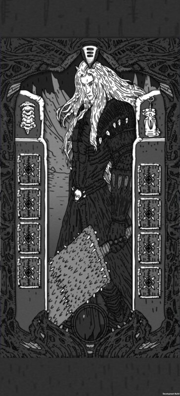
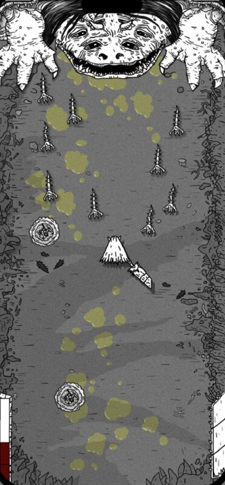
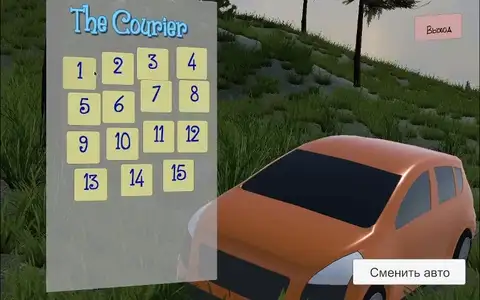

<h1 align="center">Hi there, I'm Aidar Nizamov</h1>
<h3 align="center">Mobile & Software Engineer · Flutter</h3>

I build and ship mobile apps with Flutter/Dart, from the first screen to the store release.
I also work with backend services, APIs and web development, and have worked with Linux/Kubernetes infrastructure, cybersecurity and networking, real-time video streaming and processing, and game development.
Lately I've also been exploring AI-assisted development and how far it can take a real product.

---

## 📱 Mobile Development

### [The Men's Diary](https://github.com/NGdev2/the-mens-diary-showcase) · *my own product*
A diary that helps men learn to recognize and put words to their emotions. I designed, built and released it solo.  
Offline-first: data lives locally in **Drift/SQLite** and syncs in the background with **Cloud Firestore**.
Firebase Auth and App Check, Google Play Billing for in-app purchases, personalization and a progression system.
Released after several Google Play closed-testing rounds with manual QA and tester feedback.

`Flutter` `Dart` `Riverpod` `Drift` `Firebase` `Google Play Billing`  
▸ [Google Play](https://play.google.com/store/apps/details?id=com.aidar.themensdiary) (Android) · [Screenshots, architecture & code samples](https://github.com/NGdev2/the-mens-diary-showcase)

### [StreamPilot](https://www.polyvision.tech/) · *Polyvision*
Flutter app for setting up cameras: device discovery, remote control, live video monitoring and streaming to YouTube/Twitch.  
On the device side: Python/Flask services and Bash, discovery over UDP, control over HTTP/REST, MJPEG preview.
WebRTC and RTSP pipelines were explored during R&D.

`Flutter` `Dart` `Python` `Flask` `REST` `UDP` `MJPEG`  
▸ [App Store](https://apps.apple.com/fr/app/polyvision-streampilot/id6755527112) · [Google Play](https://play.google.com/store/apps/details?id=com.polymnia.streampilot)

### Flicksy / Short Machine · *Polyvision*
Flutter app for turning long football videos into short highlight clips.
Users upload a match; the backend analyzes the video, suggests candidate moments, renders the selected clips with FFmpeg and prepares them for sharing to social platforms.
I built the mobile app and the Python video-processing services, and worked on Firebase integration, authentication, notifications and payments.

`Flutter` `Dart` `Python` `Firebase` `PyTorch` `OpenCV` `FFmpeg`  
▸ Developed and tested internally · Not publicly released

#### [Forward](https://github.com/NGdev2/forward) · *built entirely with AI*
An endless-road RPG runner for phones, and an experiment: I gave Claude Fable 5.1 an old game idea (a short note and a sketch) and left every technical and design decision to the model, iterating only through play-testing and written feedback.
I liked the result, so I used it to learn mobile monetization: opt-in rewarded ads with AdMob, GDPR consent and the Google Play release process.  
`TypeScript` `Capacitor` `AdMob` · Google Play closed testing · [Play in browser](https://ngdev2.github.io/forward/)

---

## 🧩 Backend & Software Engineering

- **StreamPilot device services**: Python/Flask and Bash services behind the mobile app (discovery, control, video preview).
- **[Life-Pro-Tips](https://github.com/NGdev2/Life-Pro-Tips)**: Django web app with user authentication, permissions, a tip-voting and reputation system, and custom middleware.
- **[DS_Python](https://github.com/NGdev2/DS_Python)**: Python for data science exercises, including packaging a module with `pyproject.toml`.

---

## ⛓️ Blockchain

### [Tokenizer](https://github.com/NGdev2/Tokenizer) · *learning project*
An ERC-20 token, AidarFteganChain42 (AFC42), that I built to learn how a smart contract goes from code to a public network: writing it, testing it, deploying it and publishing its verified source code.
A fixed supply of 4,242 tokens is minted once at deployment, with no mint function. `burn()` and `getOwner()` let the same code work as a BEP-20 token on BNB Smart Chain, and ownership changes through Ownable2Step, so the new owner has to accept.
17 automated tests cover normal use, actions that must fail and the required events. Deployment is scripted with Hardhat Ignition and every deployment is recorded in the repo.
Deployed to the Ethereum Sepolia testnet and verified on Etherscan and Blockscout, with the private key and API key kept out of the repo.

`Solidity` `Hardhat` `OpenZeppelin` `Ethereum` `ERC-20`  
▸ [GitHub](https://github.com/NGdev2/Tokenizer) · [Verified contract on Etherscan](https://sepolia.etherscan.io/address/0x3D28630D5E38f7F3da4783A8867f12121777D9c6#code)

---

## 🔐 Cybersecurity & Networking

- **[Snow Crash](https://github.com/NGdev2/Snow-Crash-cybersecurity-project)**: Linux privilege-escalation wargame: SUID binaries, injection flaws, race conditions, weak crypto, binary analysis with `gdb`/`objdump`/`ltrace`.
- **[Darkly](https://github.com/NGdev2/Darkly-42-Cybersecurity-proj-)**: web-application security audit with write-ups: SQL injection, XSS, path traversal, open redirect, cookie and header manipulation, brute force.
- **[ft_ping](https://github.com/NGdev2/ft_ping)**: reimplementation of `ping` in C with raw sockets and ICMP.

---

## ☸️ DevOps & Infrastructure

- **[Inception of Things](https://github.com/NGdev2/Inception-of-things-42)**: Vagrant-provisioned K3s clusters, Ingress routing, and GitOps with Argo CD on K3d, plus a self-hosted GitLab.
- **[ftegan](https://github.com/NGdev2/ftegan)**: Kubernetes Deployment and Service manifests for a containerized app published on Docker Hub.
- **[KodeKloud courses](https://github.com/NGdev2/KodeKloud-courses)**: hands-on labs in Linux, Git, Kubernetes (CKA prep), Terraform and Ansible, plus 100 Days of DevOps.
- **[handy-scripts](https://github.com/NGdev2/handy-scripts)**: small Python and Bash automation utilities.

---

## 🌍 Open Source

### [Earful](https://github.com/NGdev2/earful) · *my own open-source project*
A GNOME Shell extension that puts every player one click away, with each browser tab as its own player.
Browsers report one media player for all tabs, so a companion add-on for Chrome and Firefox watches each tab, and a native messaging helper publishes every tab as its own **MPRIS** player on D-Bus.
Supports GNOME 46–51 (ported to GNOME 51's new rendering APIs), installs with one command, tested headlessly in GNOME Shell, Chrome and Firefox.

`JavaScript` `GJS` `GNOME Shell` `D-Bus` `WebExtensions` `Native Messaging`  
▸ [GitHub & demo](https://github.com/NGdev2/earful) · Submitted to extensions.gnome.org, Firefox Add-ons and the Chrome Web Store (in review)

### Contributions

- **[Wave Terminal](https://github.com/wavetermdev/waveterm)**: two pull requests to this open-source terminal (TypeScript/React and Go, ~22k★): [auto-refresh for file previews when the file changes on disk](https://github.com/wavetermdev/waveterm/pull/3547), which also fixes PDF and image previews staying cached, and [an optional auto-save for the built-in editor](https://github.com/wavetermdev/waveterm/pull/3548). Both are under review.
- **[Hanabi](https://github.com/jeffshee/gnome-ext-hanabi)**: completed the French translation (79% → 100%) of this live-wallpaper extension for GNOME Shell, via [Hosted Weblate](https://hosted.weblate.org/user/NGdev2/).

---

## 🎮 Game Development

Earlier team projects, both built in Unity.

### SAIGL · *2022 · mobile game, team of four*
A dark-fantasy 2D runner for Android and iOS with hand-drawn black-and-white art. I was one of the two programmers, alongside a game designer/artist and a sound designer; we pitched it at GameLab 11.
The hero keeps moving upward: you swipe to jump, fight with an upgradable melee weapon, and finish each 1–2 minute level against a multi-stage boss.
Before playing you choose a character, and a lobby shows collected artifacts, defeated bosses and upgrades.

`Unity` `C#` `Android` `iOS`  
▸ [Gameplay video](https://youtu.be/0nY2VWSinek)

📸 <ins>Screenshots</ins>

 

  
  
  

### [The Courier](https://github.com/andreichev/TheCourier) · *2019 · team project*
A 3D driving game that trains memory: you look at the city map once, then deliver the parcel from memory.
Every run generates a new random map, so no two games are the same, and you can choose the courier's car.

`Unity` `C#`  
▸ [GitHub](https://github.com/andreichev/TheCourier)

🎬 <ins>Gameplay clip</ins>

 

---

## 🎓 42 Journey

---

## ⚙️ Tech Stack

**Mobile**  

**Backend & Web**  

**Data & Cloud**  

**DevOps & Systems**  

**Also**  

---

## 🗣️ Languages

English (C1) · French (B2) · Russian (native)

⚡ Fun fact: I love skiing, snowboarding, ice skating, playing table tennis and computer games.

---

## 📫 Get in touch

  &nbsp;&nbsp;
  &nbsp;&nbsp;
  

aidar.nizamov141@gmail.com

  

